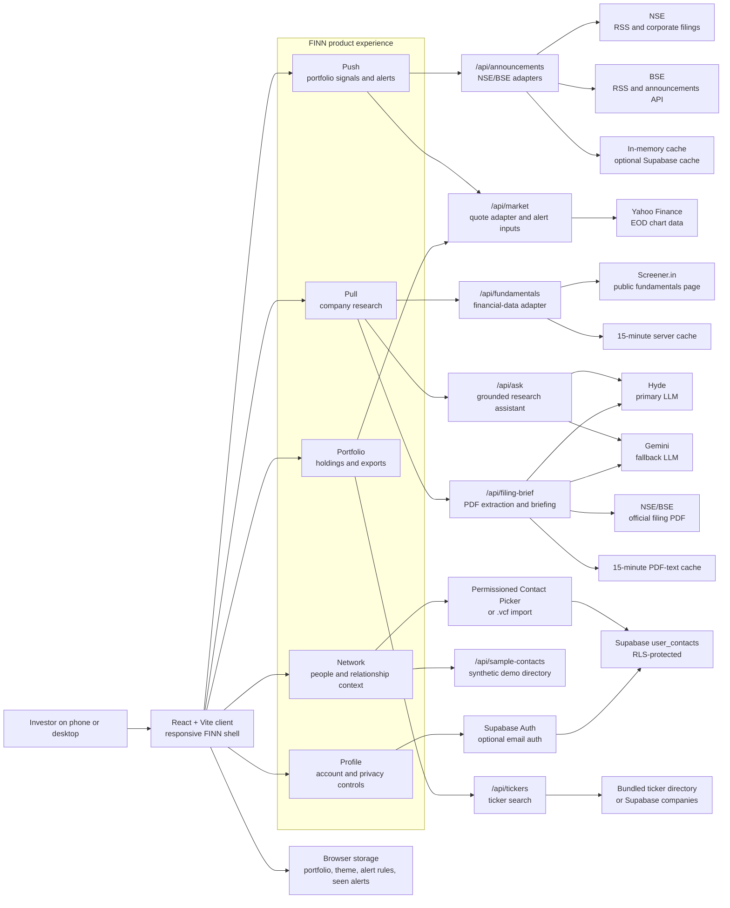

# FINN Architecture Diagram

This is the standalone architecture diagram for the FINN mobile-first investment intelligence prototype.

## Reading the diagram

- The client owns presentation, user interaction, local preferences, and safe contact-selection flows.
- Vercel server functions normalize external data and keep provider credentials private.
- NSE and BSE are the primary source for filings.
- Yahoo Finance provides end-of-day market quotes and volume inputs.
- Hyde is the primary LLM; Gemini is the fallback.
- Supabase is optional for search, caching, authentication, and user-owned contacts.
- The application labels synthetic or fallback data instead of presenting it as verified live data.

