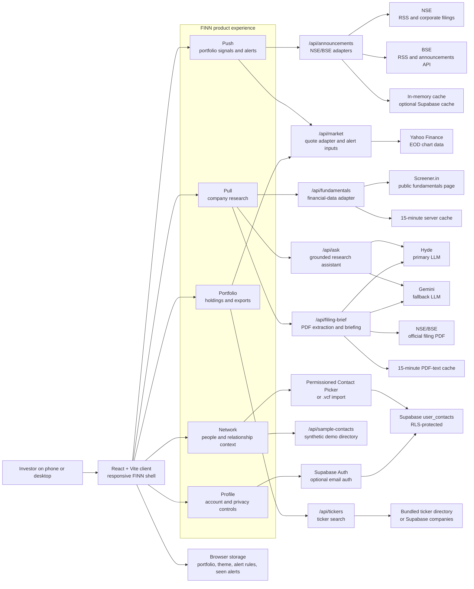

# FINN Architecture

FINN is a mobile-first investment intelligence terminal. It combines portfolio monitoring, exchange filings, financial research, and relationship context into one responsive web application.

The product is organized around three complementary workflows:

- **Push**: identify what changed across the user's portfolio.
- **Pull**: explain what the change means using company data and primary documents.
- **Network**: identify who in the user's network can add useful operating context.

The current implementation is a production-shaped prototype: the main data and AI boundaries are real, while some integrations and persistent product capabilities remain deliberately simulated or optional.

## Architecture at a glance



The same diagram is available separately in [architecture-diagram.md](architecture-diagram.md) for sharing or attaching to a submission email.

## Runtime layers

### 1. Responsive client

The frontend is a React application bundled by Vite. It uses one semantic layout for desktop and mobile rather than separate device-specific applications. The application shell provides:

- Persistent FINN header and bottom navigation.
- Push, Pull, Network, Portfolio, Profile, Ask, and Export views.
- Light and dark themes.
- Mobile-safe spacing and keyboard-friendly content flow.
- Loading, unavailable, stale, retry, and fallback states.

The primary route selection is handled in `src/main.jsx`. The more complete product views are the `Detailed*` components; the earlier simplified components remain as visual/prototype references.

### 2. Serverless API layer

The `api/` directory contains Vercel-compatible server functions. The browser does not call external market, filing, or LLM providers directly for protected or normalized workflows.

| Endpoint | Responsibility |
| --- | --- |
| `/api/announcements` | Fetch, normalize, classify, group, and cache NSE/BSE announcements. |
| `/api/market` | Fetch Yahoo Finance EOD data, normalize quotes, calculate price and volume signals, and paginate symbols. |
| `/api/fundamentals` | Retrieve and parse public company financial tables with a short-lived cache. |
| `/api/filing-brief` | Validate an exchange URL, download a bounded PDF, extract text, and generate an evidence-grounded brief. |
| `/api/ask` | Send compact, selected-company context to Hyde, then fall back to Gemini. |
| `/api/tickers` | Return ticker suggestions from Supabase when configured, otherwise the bundled directory. |
| `/api/sample-contacts` | Load synthetic network contacts from Supabase or local demo data. |

## Data pipelines

### Exchange announcements

1. Push requests a date range from the browser.
2. The server attempts the dated NSE and BSE endpoints.
3. If those endpoints fail or are unavailable, the server uses the latest-items RSS feeds.
4. Exchange-specific responses are normalized into a common announcement shape.
5. Headlines are classified into event categories.
6. Announcements are grouped by normalized company name.
7. Portfolio matching is performed using company names and canonical tickers.
8. Important filings are shown first, while routine/unclassified filings remain available behind an explicit control.
9. Dated rows may be cached in Supabase when database credentials are configured.

The feed is intentionally honest about completeness: RSS fallback is treated as a latest-items snapshot rather than a complete historical archive.

### Exchange article and filing briefs

FINN treats an exchange announcement as both a live signal and a doorway to the underlying primary document. The workflow is:

1. Push displays a normalized NSE/BSE announcement with company, category, filing date, source exchange, headline, and source link.
2. The user can open the original exchange document directly.
3. The user can select Results brief or Ask FINN from a filing-linked company card.
4. The browser sends the selected source URL, company, ticker, category, and headline to `/api/filing-brief`.
5. The server validates the URL against NSE/BSE-owned domains. It does not accept an arbitrary URL supplied by the browser.
6. Redirect destinations are validated again, preventing a trusted-looking exchange link from redirecting the server to an unrelated or internal address.
7. The server downloads the document with a 12 MB limit and confirms that the response is a PDF.
8. The PDF text is extracted server-side, capped at 42,000 characters, and cached briefly to avoid repeated downloads.
9. The extracted text is sent to Hyde, or Gemini if Hyde is unavailable, together with a strict filing-only instruction.
10. The client renders the resulting Markdown brief and keeps the official source link available for verification.

The filing brief prompt asks the model to report Revenue, EBITDA, PBT, and PAT when explicitly present; preserve the filing's units; distinguish standalone from consolidated results; include QoQ and YoY comparisons only when both periods and values are available; use unambiguous fiscal-year or period-end labels; identify disclosed guidance; and say when information is absent. The model is not allowed to fill missing values from outside knowledge or infer unsupported comparisons.

This creates three deliberately separate research modes:

- **Announcement mode**: what changed at the exchange and why it is relevant to the portfolio.
- **Filing-brief mode**: what one selected NSE/BSE document explicitly says.
- **Company-research mode**: a broader question using retrieved fundamentals, selected primary-source context, and limited network context.

### Market data and alerts

1. Portfolio symbols are sent to `/api/market` in bounded pages.
2. Yahoo Finance chart data is normalized into price, previous close, OHLC, volume, and freshness fields.
3. The server avoids treating an unfinished Indian trading-session bar as a completed daily bar.
4. The client compares daily price movement and volume multiples to the user's thresholds.
5. Filing alerts are filtered by portfolio membership and selected categories.
6. Seen alert IDs are stored locally so the same event is not repeatedly surfaced.
7. Browser notifications are optional; in-app alerts still work when browser permission is unavailable.

Alerts currently run while the page is open. Closed-app push delivery would require a server-side scheduler, subscription store, and push provider.

### Fundamentals and research

Fundamentals are retrieved only when a company is selected. The parser extracts:

- Current price, market cap, and P/E when available.
- Quarterly results and periods.
- Profit and loss.
- Balance sheet.
- Cash flow.
- Ratios.
- Revenue, EBITDA, PBT, and PAT comparisons.

The parser is deliberately bounded and cached. The current adapter uses Screener's public page structure for the prototype; a public or commercial deployment should replace it with a licensed, stable data provider.

## AI architecture

FINN has two server-side AI workflows.

### General research: `/api/ask`

The server compacts and sends only relevant context:

- Selected company and ticker.
- Retrieved fundamentals.
- Relevant primary-source context.
- Explicitly matched network context.
- The user's question.

Hyde is called first. Gemini is called if Hyde is not configured or fails. Provider names are returned to the client so the UI can show which service answered.

The prompt enforces several boundaries:

- Do not substitute another company.
- Do not use unsupported outside knowledge.
- Do not invent figures, guidance, biographies, links, or citations.
- Mark missing evidence and inference.
- Treat synthetic people as unverified.
- Do not provide personal buy/sell recommendations.

### Filing brief: `/api/filing-brief`

The filing workflow is more constrained than general Q&A:

1. Validate that the URL belongs to an official NSE or BSE-owned domain.
2. Reject embedded credentials and non-HTTP protocols.
3. Upgrade HTTP exchange links to HTTPS.
4. Validate every redirect destination.
5. Limit the download to 12 MB.
6. Confirm the response is a PDF.
7. Extract at most 42,000 characters.
8. Ask the model to use only the extracted filing text.
9. Preserve units and distinguish standalone from consolidated results.
10. Require explicit periods for QoQ and YoY comparisons.

This design reduces unsupported model claims and also protects the server from arbitrary URL fetching.

The UI exposes the filing source alongside the answer so the user can move from summary back to evidence. This is important for an investment workflow: the AI is an interpretation layer over the document, not a replacement for the primary filing.

## Storage and state

### Browser state

The prototype stores user-facing state locally:

- Theme preference.
- Portfolio holdings.
- Alert preferences and threshold values.
- Seen filing and market-alert IDs.
- Imported phone contacts for the current session.
- Account session metadata.

### Optional Supabase state

The database schema contains:

- `companies`: searchable ticker directory.
- `exchange_announcements`: normalized announcement cache.
- `sample_network_contacts`: synthetic demo profiles.
- `user_contacts`: user-owned selected/imported contacts.

`user_contacts` is protected with row-level security so an authenticated user can read and insert only their own contacts.

## Security and privacy decisions

- Provider API keys stay in server environment variables.
- Arbitrary filing URLs are not accepted.
- Filing redirects are revalidated.
- PDF size and text limits reduce resource abuse.
- Contact access requires an explicit browser action or file import.
- The app does not silently scan SMS or the full address book.
- Synthetic network profiles are labelled as fictional/demo data.
- Contact syncing is optional and requires authentication.
- User contacts are tenant-scoped through Supabase row-level security.
- External source URLs are preserved so users can inspect primary documents themselves.

## Reliability and UX decisions

- Buttons are disabled while important asynchronous actions are running.
- Research requests cannot be submitted repeatedly while loading.
- Refresh buttons show progress and cannot be clicked repeatedly during a refresh.
- Contact actions use busy state to avoid opening duplicate flows.
- Effects cancel or ignore stale responses when the selected company changes.
- Provider fallback keeps AI usable when the primary provider is unavailable.
- Database and live-data failures fall back to bundled/demo data where safe.
- Sample values are labelled instead of being presented as live data.
- Threshold fields use draft values so users can clear and edit numbers naturally before committing them.

## Deliberate prototype boundaries

The following items are intentionally not presented as complete production integrations:

- LinkedIn profiles are synthetic.
- WhatsApp is a deep-link/share flow, not private WhatsApp data access.
- Gmail and Telegram OAuth are not yet connected.
- Browser alerts work while the page is open, not as a complete background push service.
- Screener and Yahoo Finance adapters are suitable for the prototype, not a final licensed data contract.
- Portfolio totals and some visual summary cards remain illustrative.
- Full multi-tenant portfolio persistence is not yet implemented.

## Recommended next steps

1. Add authenticated, tenant-scoped portfolio and alert storage.
2. Replace public-page scraping with licensed market and fundamentals providers.
3. Build scheduled filing ingestion and document chunking with retrieval indexes.
4. Add source-level citations and evidence spans to AI answers.
5. Add production rate limiting, observability, audit logs, and error tracing.
6. Implement consent-based Gmail, Telegram, and network integrations.
7. Add a server-side push notification service for closed-app alerts.
8. Add automated end-to-end tests for mobile layouts, duplicate actions, stale requests, and source validation.

## Repository map

```text
src/main.jsx             React application and product workflows
src/styles.css           Responsive visual system and mobile layout
src/data.js              Demo company and UI context data
src/ticker-directory.js  Bundled ticker fallback
src/auth.js              Supabase email auth and contact sync
api/announcements.js     NSE/BSE filing ingestion
api/market.js            Yahoo Finance market adapter
api/fundamentals.js      Fundamentals adapter and parser
api/filing-brief.js      Filing validation, PDF extraction, and AI brief
api/ask.js               Grounded AI Q&A with provider fallback
api/tickers.js           Ticker search adapter
api/db.js                Optional Supabase data access
db/schema.sql            Supabase schema and security policies
design.md                Product and implementation contract
architecture.md          This architecture document
architecture-diagram.md  Standalone Mermaid architecture diagram
```

